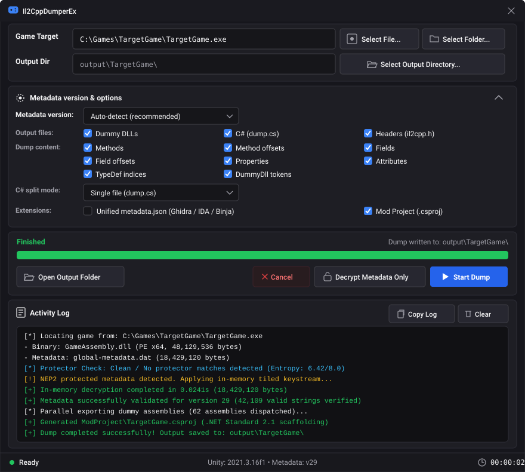

<p align="center">
  
</p>

# Il2CppDumperEx

<p align="center">
  <a href="https://github.com/0x7flumic/Il2CppDumperEx/releases">
    
  </a>
  
  <a href="https://github.com/0x7flumic/Il2CppDumperEx/actions/workflows/release.yml">
    
  </a>
  
  
  
</p>

**Il2CppDumperEx** is an automated reverse engineering suite for Unity IL2CPP games. It integrates automatic game file discovery, NEP2 metadata decryption, deterministic version validation (v16–v39), and Il2CppDumper decompilation into a single tool with both a modern GUI and a scriptable CLI.

---

## Features

- **Automated Game Discovery:** Point to a game directory, `<Game>_Data` folder, or main `.exe`. Automatically locates binaries (`GameAssembly.dll`, `libil2cpp.so`) and `global-metadata.dat`.
- **NEP2 Decryption:** Detects and decrypts protected metadata using precomputed tiled masks.
- **Wide Metadata Version Support (v16–v39):** Supports legacy Unity releases through modern Unity 6 metadata formats (v35, v38, v39) via deterministic header and string-heap validation.
- **Dual Interface:** Modern Windows 11 Fluent dark GUI with real-time log streaming, and a scriptable CLI for automation and headless workflows.

---

## Usage

### Graphical Interface (GUI)

<p align="center">
  
</p>

Run `Il2CppDumperEx.exe`:
1. **Target Selection:** Drag and drop any game executable, game root folder, or `*_Data` directory onto the window (or click **Browse**).
2. **Advanced Options (Optional):** Expand the panel to configure:
   - **Metadata Version:** Select `Auto-detect (recommended)` or lock to a specific version (v16–v39).
   - **Output Files:** Enable or disable `Dummy DLLs`, `C# (dump.cs)`, or `Headers (il2cpp.h / script.json)`.
   - **Dump Content:** Toggle inclusion of `Methods`, `Method offsets`, `Fields`, `Field offsets`, `Properties`, and `Attributes`.
3. **Start:** Click **Start Dump**. The log streams in real-time and an **Open Output Folder** button appears when finished. Output artifacts are saved to `output/<GameName>/`.

### Command-Line Interface (CLI)
```bash
# Basic run: auto-discovers game binary and metadata
Il2CppDumperEx "C:\Games\TargetGame"

# Target specific executable and custom output folder
Il2CppDumperEx "C:\Games\TargetGame\Game.exe" --out "C:\Dumps\TargetGame"

# Force specific metadata version
Il2CppDumperEx "C:\Games\TargetGame" --force-version 31

# Customize output artifacts
Il2CppDumperEx "C:\Games\TargetGame" --no-dummy-dll --no-struct
```

#### CLI Options Reference
| Option | Description |
| :--- | :--- |
| `game_path` | Path to game folder, `<Game>_Data` directory, or `.exe` |
| `--out <dir>` | Destination folder for dump outputs (default: `./output/<GameName>`) |
| `--force-version <N>` | Manually specify metadata version (e.g. `29`, `31`, `38`) |
| `-v`, `--verbose` | Output detailed diagnostic logs |
| `--no-dummy-dll` | Skip generating stripped .NET assemblies (`DummyDll/`) |
| `--no-struct` | Skip generating C/C++ struct definitions (`il2cpp.h`, `script.json`, `stringliteral.json`) |
| `--no-method` | Skip dumping method signatures |
| `--no-field` | Skip dumping fields |
| `--no-property` | Skip dumping properties |
| `--no-attribute` | Skip dumping custom attributes |
| `--no-field-offset` | Skip dumping field memory offsets |
| `--no-method-offset` | Skip dumping method memory pointers |
| `--no-typedef-index` | Skip dumping TypeDef indices |
| `--no-token` | Do not attach metadata tokens to DummyDll types |

---

## Output Files

| File / Directory | Description |
| :--- | :--- |
| `dump.cs` | Decompiled C# pseudocode declarations with classes, methods, fields, and properties |
| `il2cpp.h` | C/C++ struct headers and function declarations for IDA Pro, Ghidra, and Binary Ninja |
| `script.json` | Symbol addresses, method pointers, and metadata indices (compatible with standard Il2CppDumper scripts) |
| `stringliteral.json` | Decoded string literal addresses and string contents |
| `DummyDll/` | Stripped .NET reference assemblies readable in dnSpy, ILSpy, or Visual Studio |

---

## Disassembler & Decompiler Scripts

The [`scripts/`](scripts/) directory contains helper loaders to import `script.json` and `il2cpp.h` directly into native reverse engineering tools:

| Tool | Script | Description |
| :--- | :--- | :--- |
| **IDA Pro** | [`scripts/ida/ida_with_struct_py3.py`](scripts/ida/ida_with_struct_py3.py) | **Recommended (Python 3):** Loads `script.json` symbols and imports `il2cpp.h` structs and function definitions |
| | [`scripts/ida/ida_py3.py`](scripts/ida/ida_py3.py) | Renames methods and string literals from `script.json` (Python 3) |
| | [`scripts/ida/ida_with_struct.py`](scripts/ida/ida_with_struct.py) | Struct + symbol loader for legacy Python 2 IDA installations |
| **Ghidra** | [`scripts/ghidra/ghidra_with_struct.py`](scripts/ghidra/ghidra_with_struct.py) | **Recommended:** Applies `script.json` symbol names, strings, and imports `il2cpp.h` structs via Ghidra C-parser |
| | [`scripts/ghidra/ghidra.py`](scripts/ghidra/ghidra.py) | Standard symbol and string literal importer |
| | [`scripts/ghidra/ghidra_wasm.py`](scripts/ghidra/ghidra_wasm.py) | Importer for WebAssembly IL2CPP targets |
| **Binary Ninja** | [`scripts/binaryninja/`](scripts/binaryninja/) | Plugin package (`plugin.json` / `__init__.py`) to import symbols and types |
| **Hopper** | [`scripts/hopper/hopper-py3.py`](scripts/hopper/hopper-py3.py) | Symbol and string annotator for Hopper Disassembler v4+ |

### Usage Guide

#### IDA Pro
1. Open and disassemble `GameAssembly.dll` (or `libil2cpp.so`) in IDA and wait for initial auto-analysis to finish.
2. Select **File** &rarr; **Script file...** (or press `Alt + F7`).
3. Choose [`scripts/ida/ida_with_struct_py3.py`](scripts/ida/ida_with_struct_py3.py) (for IDA 7.4+ with Python 3).
4. When prompted by the file dialogs:
   - Select `script.json`
   - Select `il2cpp.h`
5. The script parses C declarations via `parse_decls()`, applies struct types, renames function symbols, and annotates string literals.

#### Ghidra
Because Ghidra's built-in C-parser cannot directly parse raw C++ style inheritance syntax (`: Parent {`), follow this 3-step import process:
1. **Preprocess the header:** Run [`scripts/ghidra/il2cpp_header_to_ghidra.py`](scripts/ghidra/il2cpp_header_to_ghidra.py) in the same directory as `il2cpp.h` to generate `il2cpp_ghidra.h`:
   ```bash
   python scripts/ghidra/il2cpp_header_to_ghidra.py
   ```
2. **Parse data types:** In Ghidra, open your project, go to **File** &rarr; **Parse C Source...**, clear existing entries, add `il2cpp_ghidra.h`, and click **Parse to Program** to import all structs into Ghidra's Data Type Manager.
3. **Apply symbols and signatures:** Open Ghidra's **Script Manager** (`Window` &rarr; `Script Manager`), add `scripts/ghidra/` to your script directories, select and run [`scripts/ghidra/ghidra_with_struct.py`](scripts/ghidra/ghidra_with_struct.py), and choose `script.json` when prompted.

---

## Building from Source

### Prerequisites
- Windows 10/11 x64
- .NET 9 SDK

```powershell
.\build.ps1
```
Builds and verifies tests, publishing `publish\Il2CppDumperEx.exe`.

---

## Credits & Licenses
- **[Il2CppDumper](https://github.com/Perfare/Il2CppDumper)** by Perfare & **[c01ns fork](https://github.com/c01ns/Il2CppDumper)** (MIT License)
- **[Mono.Cecil](https://github.com/jbevain/cecil)** by Jb Evain (MIT License)
- **[WPF-UI](https://github.com/lepoco/wpfui)** by Leszek Pomianowski (MIT License)
- **NEP2 Research:** [YuroGod](https://github.com/YuroGod/metadata_decrypt)
- **Application Icon:** <a href="https://www.flaticon.com/free-icons/game-development" title="game development icons">Game development icons created by andinur - Flaticon</a>
