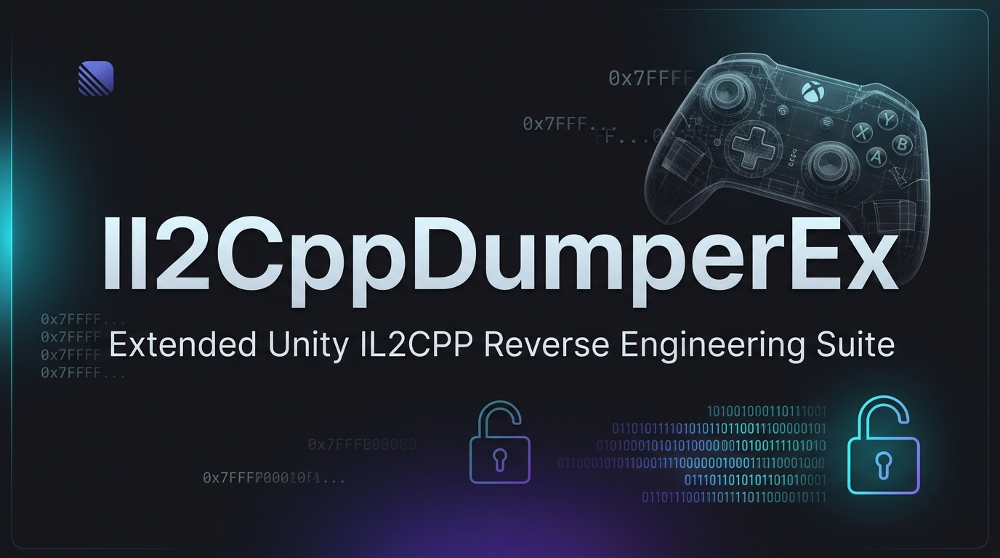

<p align="center">
  
</p>

# Il2CppDumperEx

<p align="center">
  
  
  
</p>

**Il2CppDumperEx** is an automated reverse engineering suite for Unity IL2CPP games across PC, mobile, and console platforms. It integrates direct archive ingestion (`.apk`, `.aab`, `.zip`, `.ipa`), automatic binary and metadata resolution, in-memory NEP2 metadata decryption, deterministic version validation (v16–v110), container unwrapping (PlayStation SElf, Switch NSO, Mach-O Fat slices, memory dumps), and symbol export into both a modern Windows 11 Fluent dark GUI and an automation-ready CLI.

> [!WARNING]
> ### ⚖️ Reverse Engineering & Legal Disclaimer
> Il2CppDumperEx is strictly intended for software interoperability analysis, security auditing, digital preservation, and educational reverse engineering of Unity software. This tool must not be used to bypass digital rights management (DRM), compromise online multiplayer games, infringe copyrighted intellectual property, or violate software End User License Agreements (EULAs). The authors do not endorse or assume liability for unauthorized or illegal use of this software.

---

## Key Features

- **Automated Game Discovery:** Drop a game executable, `<Game>_Data` folder, or direct archive package (`.apk`, `.aab`, `.zip`, `.ipa`). Automatically isolates binaries (`GameAssembly.dll`, `libil2cpp.so`, `UnityFramework`, `main.nso`, `Il2CppUserAssemblies.prx`, `eboot.bin`, `maps.txt`) and `global-metadata.dat`.
- **In-Memory NEP2 Decryption:** Identifies and decrypts protected metadata using precomputed tiled substitution masks on the fly, or via standalone `--decrypt-only` mode.
- **Unity 6 (v38+) & Modern .NET Support:** In-process pattern search and symbol heuristics supporting `System.Private.CoreLib.dll` and metadata versions up to v39 / Unity 6 (v104–v110).
- **Multi-Platform Containers:** Native unwrapping for Nintendo Switch NSO (Zstandard/LZ4 with `R_AARCH64_GLOB_DAT`/`JUMP_SLOT` relocations), PlayStation 4/5 SElf, Apple iOS/macOS Mach-O Fat slices, and reconstructed Linux/Android `/proc/<pid>/maps` dumps via on-demand virtual sparse streams.
- **High-Performance Parallel Export:** Multi-threaded dummy assembly export via `Parallel.ForEach` with automatic sequential fallback.
- **Mod Project Scaffolding:** Emits ready-to-build `.NET Standard 2.1` / C# plugin project (`ModProject/`) configured to link against exported dummy assemblies with zero manual setup.
- **Packer & Entropy Analysis:** Detects commercial packers (ACE, YiDun, SecNeo, VMProtect, Themida, Denuvo) and measures code segment Shannon entropy.
- **Disassembler Integration:** Generates standard `il2cpp.h`, `script.json`, `stringliteral.json`, unified `metadata.json`, and configurable C# decompiler output (single file, split by assembly, or split by namespace tree).

---

## Documentation & Usage

For full GUI walkthroughs, CLI arguments reference, container format guides, and disassembler setup (IDA Pro, Ghidra, Binary Ninja):

👉 **[Read the Full User Guide & Technical Manual (USAGE_GUIDE.md)](USAGE_GUIDE.md)**

---

## Building from Source

Requires the [.NET 11 SDK](https://dotnet.microsoft.com/download/dotnet/11.0).

- **Windows (GUI & CLI):**
  ```powershell
  .\build.ps1
  ```
- **Linux & macOS (CLI):**
  ```bash
  dotnet publish src/Il2CppDumperEx/Il2CppDumperEx.csproj -c Release -f net11.0 -r linux-x64 --self-contained false -p:PublishSingleFile=true -o publish
  ```

---

## Credits & Licenses

- **[Il2CppDumper](https://github.com/Perfare/Il2CppDumper)** by Perfare & **[c01ns fork](https://github.com/c01ns/Il2CppDumper)** (MIT License) — decompilation engine, symbol extraction, and executable formats.
- **[Il2CppInspectorRedux](https://github.com/LukeFZ/Il2CppInspectorRedux)** by LukeFZ & **[Il2CppInspector](https://github.com/djkaty/Il2CppInspector)** by Katy Coe (AGPL-3.0 License) — disassembler scripts and Mach-O Fat slice handling.
- **[Mono.Cecil](https://github.com/jbevain/cecil)** by Jb Evain (MIT License) — stripped Dummy DLL reference assembly generation.
- **[WPF-UI](https://github.com/lepoco/wpfui)** by Leszek Pomianowski (MIT License) — Windows 11 Fluent dark theme and controls.
- **[ZstdSharp.Port](https://github.com/oleg-st/ZstdSharp)** by Oleg Stefaniuk (MIT License) — Zstandard / ZBIC decompression for Nintendo Switch NSO binaries.
- **NEP2 Research:** [YuroGod](https://github.com/YuroGod/metadata_decrypt) — reverse engineering of the NetEase NEP2 metadata substitution cipher.
- **Application Icon:** <a href="https://www.flaticon.com/free-icons/game-development" title="game development icons">Game development icons created by andinur - Flaticon</a>
