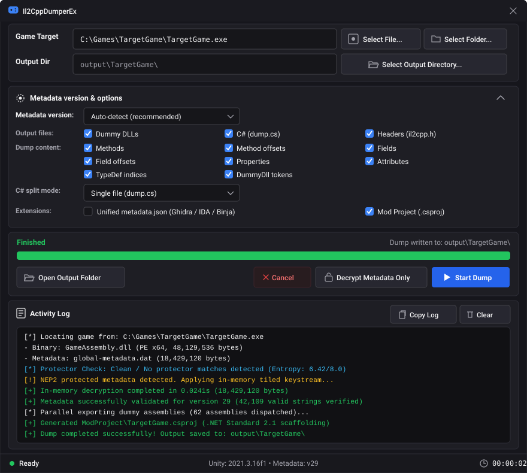

# 📖 Il2CppDumperEx User Guide & Technical Manual

Welcome to the technical reference manual for **Il2CppDumperEx**. This guide documents all supported platforms, archive handling, command-line operations, container unwrapping features, and disassembler integration workflows.

---

<div id="table-of-contents"></div>

<p align="center">
  <a href="#gui"><b>🖥️ Graphical Interface</b></a> &nbsp;•&nbsp;
  <a href="#cli"><b>⌨️ Command-Line</b></a> &nbsp;•&nbsp;
  <a href="#formats"><b>📦 Formats &amp; Platforms</b></a> &nbsp;•&nbsp;
  <a href="#deep-dive"><b>🔬 Technical Internals</b></a> &nbsp;•&nbsp;
  <a href="#disassemblers"><b>🛠️ Disassemblers</b></a>
</p>

---

<div id="gui"></div>

<p align="center">
  <a href="#table-of-contents"></a>
</p>

<p align="center">
  
</p>

Launch `Il2CppDumperEx.exe` directly or run `Il2CppDumperEx --gui [optional_target_path]` to start the Fluent dark interface:

### 1. Target Ingestion
Drag and drop any of the following targets onto the window:
- A game directory or `<Game>_Data` folder.
- A Windows game executable (`.exe`).
- An archive package (`.apk`, `.aab`, `.zip`, `.ipa`).
- An unpacked console folder (Switch `romfs`/`exefs` or PS4/PS5 title folder).
- A standalone `global-metadata.dat` or `global-metadata.dec` file.
- A Linux/Android memory dump folder containing `maps.txt`.

### 2. Advanced Configuration
Expand the **Advanced Options** drawer to configure:
- **Metadata Version Lock:** Leave on `Auto-detect (recommended)` or pin to a specific version (v16 through v39, plus Unity 6 versions 104, 105, 106, 108, and 110).
- **C# Split Mode:**
  - `Single file (dump.cs)`: Emits all decompiled declarations into one file.
  - `Split by Assembly`: Emits separate files per assembly into `CSharp/<AssemblyName>.cs`.
  - `Split by Namespace`: Generates a directory tree matching the namespace hierarchy with one source file per leaf namespace (e.g. `CSharp/UnityEngine/UI.cs` contains all types in `UnityEngine.UI`, or `CSharp/Global.cs` for types without a namespace).
- **Output Artifact Toggles:** Toggle generation of `Dummy DLLs`, `C# Pseudocode`, `C/C++ Headers & Script JSON`, and `Unified JSON (metadata.json)`.
- **Dump Content Checkboxes:** Selectively toggle inclusion of `Methods`, `Method offsets`, `Fields`, `Field offsets`, `Properties`, and `Attributes`. *(Note: TypeDef indices and DummyDll tokens are enabled by default in the GUI and can be toggled in headless mode using the `--no-typedef-index` and `--no-token` CLI flags).*

### 3. Execution & Artifact Navigation
Click **Start Dump**. The integrated log console streams live pipeline output, including packer detection, code entropy ratings, NEP2 decryption milestones, and validated string counts. Once completed, click **Open Output Folder** to immediately browse your outputs in Windows Explorer.

<p align="right"><a href="#table-of-contents">⬆ Back to Top</a></p>

---

<div id="cli"></div>

<p align="center">
  <a href="#table-of-contents"></a>
</p>

Il2CppDumperEx features a CLI designed for automation, batch scripts, and headless build pipelines.

### CLI Syntax
```bash
Il2CppDumperEx <game_path_or_metadata> [options]
```

> [!NOTE]
> On Linux and macOS, grant executable permissions to the binary prior to running:
> ```bash
> chmod +x Il2CppDumperEx
> ./Il2CppDumperEx <game_path_or_metadata> [options]
> ```

### Options Reference Table

| Switch | Arguments | Description | Default |
| :--- | :--- | :--- | :--- |
| `<game_path>` | `<path>` | Path to folder, `.exe`, `.apk`, `.aab`, `.zip`, `.ipa`, or `global-metadata.dat` | **Required** |
| `-d`, `--decrypt-only` | `[out_path]` | Decrypts and validates `global-metadata.dat` in standalone mode, skipping decompilation | Disabled |
| `--out` | `<directory>` | Explicit destination directory for generated output artifacts | `./output/<GameName>` |
| `--force-version` | `<integer>` | Overrides version auto-detection and forces a specific metadata version (e.g. `29`, `31`, `38`) | Auto-detect |
| `--split-mode` | `<mode>` | C# decompiler output mode: `none` (`dump.cs`), `assembly` (`CSharp/<Asm>.cs`), `namespace` (`CSharp/<Parent>/<Leaf>.cs`) | `none` |
| `--unified-json` | *None* | Generates consolidated `metadata.json` symbol map for external tools and automation | Disabled |
| `--no-cs` | *None* | Skips decompiling C# source code (`dump.cs` or `CSharp/` directory) | Enabled |
| `-v`, `--verbose` | *None* | Enables detailed diagnostic logs, memory offsets, and exception stack traces | Disabled |
| `--no-dummy-dll` | *None* | Skips generating stripped .NET reference assemblies (`DummyDll/`) | Enabled |
| `--no-struct` | *None* | Skips generating C/C++ struct definitions (`il2cpp.h`, `script.json`, `stringliteral.json`) | Enabled |
| `--no-method` | *None* | Excludes method signatures from decompilation | Enabled |
| `--no-field` | *None* | Excludes fields from decompilation | Enabled |
| `--no-property` | *None* | Excludes properties from decompilation | Enabled |
| `--no-attribute` | *None* | Excludes custom attributes from decompilation | Enabled |
| `--no-field-offset` | *None* | Excludes field memory offsets | Enabled |
| `--no-method-offset` | *None* | Excludes method memory pointers | Enabled |
| `--no-typedef-index` | *None* | Excludes TypeDef index annotations | Enabled |
| `--no-token` | *None* | Suppresses metadata tokens in `DummyDll/` types | Enabled |
| `--gui` | `[path]` | Explicitly launches the graphical interface with an optional preloaded path | — |
| `-h`, `--help` | *None* | Displays CLI syntax and option summary | — |

---

### Real-World CLI Recipes

#### 1. Standard Windows PC Game
Automatically detects `GameAssembly.dll` and `<Game>_Data/il2cpp_data/Metadata/global-metadata.dat`:
```bash
Il2CppDumperEx "C:\Games\UnityGame"
```

#### 2. Mobile Package Direct Ingestion (Android APK / AAB)
Extracts directly in memory/sandbox, isolates 64-bit ARM (`arm64-v8a`) binary and metadata:
```bash
Il2CppDumperEx "C:\Downloads\com.example.game.apk" --out "C:\Dumps\ExampleGame"
```

#### 3. iOS Package Ingestion (Apple IPA)
Unpacks payload, locates `UnityFramework` Mach-O Fat binary, extracts the 64-bit slice, and dumps symbols:
```bash
Il2CppDumperEx "C:\Downloads\Game.ipa" --out "C:\Dumps\Game_iOS"
```

#### 4. Disassembler Export with Unified JSON & Assembly Splitting
Emits consolidated `metadata.json` for automation/custom tooling and organizes decompiled C# classes by assembly:
```bash
Il2CppDumperEx "C:\Games\TargetGame" --unified-json --split-mode assembly --out "C:\Dumps\TargetGame"
```

#### 5. Standalone Metadata Decryption
Decrypts a protected `global-metadata.dat` file directly without needing game binaries or decompiler execution:
```bash
Il2CppDumperEx "C:\Games\TargetGame\global-metadata.dat" --decrypt-only "C:\Dumps\decrypted_metadata.dat"
```

#### 6. Headless CI / Batch Build Pipeline
Runs silently, emits only essential artifacts without reference DLLs:
```bash
Il2CppDumperEx "C:\Builds\MyGame" --out "C:\Artifacts" --no-dummy-dll
```

<p align="right"><a href="#table-of-contents">⬆ Back to Top</a></p>

---

<div id="formats"></div>

<p align="center">
  <a href="#table-of-contents"></a>
</p>

Il2CppDumperEx handles multiple target formats across desktop, mobile, and console platforms. Depending on the packaging, some files can be ingested directly as archives, while others require preliminary unpacking from encrypted store containers.

### Target Classification & Ingestion Requirements

| Platform / Format | Direct Ingestion? | Supported Files / Layout | Notes & Requirements |
| :--- | :---: | :--- | :--- |
| **Android APK / AAB** | **Yes** | `.apk`, `.aab`, `.zip` | Directly drag or pass file. Extracts automatically; selects `arm64-v8a` over `armeabi-v7a`. |
| **Apple iOS IPA** | **Yes** | `.ipa`, `.zip` | Directly drag or pass file. Extracts `Payload/<App>.app`, isolates `UnityFramework` Mach-O binary. |
| **Windows PC** | **Yes** | Game root folder, `<Game>_Data`, or `<Game>.exe` | Automatically resolves `GameAssembly.dll` and `il2cpp_data/Metadata/global-metadata.dat`. |
| **Nintendo Switch** | **Unpacked** | Game dump directory containing `romfs/` and `main.nso` (or `main`) | **NSP / XCI packages must be unpacked first.** Use tools like `hactool`, `Ryujinx`, or `Yuzu` dump tools to extract RomFS (`romfs/Data/`) and ExeFS (`main.nso`). |
| **Sony PlayStation 4 / 5** | **Unpacked** | Title folder containing `sce_sys/param.json` or `param.sfo`, and `Il2CppUserAssemblies.prx` or `eboot.bin` | **PKG packages must be unpacked/decrypted first.** Pass the extracted directory containing decrypted SElf binaries and metadata. |
| **Linux / Android Memory Dump** | **Yes** | Directory with `maps.txt` (or `*-maps.txt`) and memory range binaries `*-<start>-<end>.bin` | Reconstructs dumped memory segments into a contiguous ELF image automatically. |
| **WebAssembly (WASM)** | **Yes** | WebAssembly binary (`.wasm` or memory stream with magic `\0asm`) | Directly analyzed; memory stream created from data section relocations. Includes dedicated `scripts/ghidra/ghidra_wasm.py` loader. |
| **Standalone Metadata** | **Yes** | `global-metadata.dat`, `global-metadata.dec` | Directly analyzed and decrypted via `--decrypt-only`. |

<p align="right"><a href="#table-of-contents">⬆ Back to Top</a></p>

---

<div id="deep-dive"></div>

<p align="center">
  <a href="#table-of-contents"></a>
</p>

### 1. Linux / Android Process Memory Maps Reader

#### The Problem
Modern Android and mobile games often deploy runtime packers or native anti-tamper wrappers that keep `libil2cpp.so` encrypted or unpacked only in volatile process memory. Static extraction from disk yields scrambled or incomplete code segments.

#### How It Works
Il2CppDumperEx features an automated memory reconstruction engine:
1. **Detection:** When pointed to a directory or a `maps.txt` file (matching `maps.txt`, `*-maps.txt`, or `maps`), `ProcessMapReader.IsProcessMapFile()` verifies the map descriptor file.
2. **Virtual Memory Layout Parsing:** It reads each memory region line matching:
   ```text
   <start>-<end> <perms> <offset> <dev> <inode> <path>
   7b4a000000-7b4a200000 r-xp 00000000 ... /data/app/.../libil2cpp.so
   ```
   It filters for mapped memory regions associated with `libil2cpp.so` and calculates the minimum base virtual address (`baseAddress`) and total memory span (`maxEnd - minStart`).
3. **Chunk Matching & Assembly:** The reader discovers all dumped memory chunk files matching the pattern:
   ```text
   <prefix>-<start_hex>-<end_hex>.bin
   ```
   (e.g., `dump-7b4a000000-7b4a200000.bin`). It verifies that all chunks fall within the virtual range, orders them by starting address, and stitches them into a contiguous, zero-padded `MemoryStream`.
4. **ELF Re-alignment:** If the original ELF header is situated at `baseAddress`, the resulting memory stream is loaded as a 64-bit or 32-bit ELF image, enabling the decompilation engine to resolve method pointers and string literals against live runtime memory.

```bash
# Point directly to directory containing maps.txt and .bin chunks
Il2CppDumperEx "C:\Dumps\ProcessMemoryDump" --out "C:\Dumps\Reconstructed"
```

---

### 2. Apple Mach-O Universal / Fat Binary Slices

#### The Problem
macOS and iOS applications frequently package binaries as Mach-O Universal (Fat) binaries (`UnityFramework` or application binaries). These contain multiple architecture slices (e.g. 32-bit ARMv7, 64-bit ARM64, x86_64, ARM64e) wrapped inside a single file with a global `fat_header`.

#### How It Works
1. **Header Identification:** The loader checks the magic header. If it detects Mach-O Fat magic (`0xCAFEBABE` / `0xBEBAFECA`), it instantiates `MachoFat`.
2. **Slice Architecture Parsing:** It reads the big-endian `fat_header` and enumerates all architecture slice descriptors:
   - Evaluates slice offsets and sizes.
   - Inspects each slice's embedded Mach-O magic number (`0xFEEDFACF` for 64-bit Mach-O, `0xFEEDFACE` for 32-bit Mach-O).
3. **Automatic 64-Bit Priority:** Il2CppDumperEx iterates through available slices and automatically selects the first 64-bit architecture slice (`0xFEEDFACF`, e.g. ARM64 or x86_64):
   ```csharp
   int selectedIndex = 0;
   for (int i = 0; i < machoFat.fats.Length; i++)
   {
       if (machoFat.fats[i].magic == 0xFEEDFACF) // 64-bit Mach-O
       {
           selectedIndex = i;
           break;
       }
   }
   ```
4. **Clean Slice Extraction:** `MachoFat.GetMacho(selectedIndex)` slices the exact byte slice from the stream and forwards it directly to `Macho64`, bypassing the need for manual `lipo` extraction.

---

### 3. NEP2 Metadata Decryption (`--decrypt-only`)

#### Overview
When analyzing Unity IL2CPP games, you may only have extracted `global-metadata.dat` (or `.dec`) without the matching executable binary (`GameAssembly.dll` or `libil2cpp.so`), or you may want to verify that an encrypted metadata file can be decrypted before running a full decompilation. The `--decrypt-only` (or `-d`) switch runs standalone metadata decryption and validation without requiring game binaries or invoking the decompilation engine.

> [!NOTE]
> **Supported Encryption:** Automated decryption is specifically implemented for **NetEase NEP2** (a tiled substitution cipher used in NetEase-protected Unity games). Il2CppDumperEx does **not** contain automated decrypters for other encryption schemes (such as AES, custom rolling XOR, or other anti-cheat wrappers like Tencent ACE or SecNeo). Files protected by non-NEP2 algorithms must be dumped from active process memory first.

#### CLI Usage Examples
```bash
# Basic usage: output saved to target directory as global-metadata-decrypted.dat
Il2CppDumperEx "C:\Games\TargetGame\global-metadata.dat" --decrypt-only

# Specify a custom output file destination
Il2CppDumperEx "C:\Games\TargetGame\global-metadata.dat" --decrypt-only "C:\Dumps\clean_metadata.dat"

# Lock to a specific metadata version candidate (e.g. version 31)
Il2CppDumperEx "C:\Games\TargetGame\global-metadata.dat" --decrypt-only "C:\Dumps\clean_metadata.dat" --force-version 31
```

---

### 4. Nintendo Switch NSO Decompression (Zstandard & LZ4)

Nintendo Switch `main.nso` executables store `.text`, `.rodata`, and `.data` segments. Recent Switch SDKs compress these segments using Zstandard (`ZBIC`) or LZ4.
- `NSO.cs` reads segment headers, validates uncompressed sizes, and automatically detects compression flags.
- Decompresses segments in-memory into contiguous executable memory buffers before symbol mapping.

---

### 5. Sony PlayStation 4/5 SElf Unwrapping

PlayStation 4 and PlayStation 5 executables (`.prx`, `eboot.bin`, `libil2cpp.so`) are encapsulated in Signed ELF (`SElf`) / Fake ELF (`FElf`) containers.
- `SElf.cs` identifies SElf magic (`0x1D3D154F` / `0xEEF51454`), parses segment descriptors, and unwraps unencrypted Fake SElf (`FSelf`) container headers into a standard 64-bit ELF image in memory. *(Note: Retail signed SElf files require PlayStation hardware keys and must be decrypted prior to loading).*

---

### 6. Anti-Cheat, Packer & Shannon Entropy Fingerprinting

During discovery, `ProtectorDetector.cs` performs diagnostic checks:
- **Commercial Packer & Wrapper Signatures:** Detects Tencent Legu/ACE (`libshell.so`, `libtersafe.so`), NetEase YiDun (`libnesec.so`), SecNeo (`libsecmain.so`), Qihoo 360 Jiagu (`libjiagu.so`), and Ijiami (`libexec.so`).
- **Binary Protectors:** Detects section headers for VMProtect (`.vmp0`), Themida (`.themida`), and Denuvo (`.bind`, `.arch`).
- **Shannon Entropy Analysis:** Computes entropy over executable code segments ($H(X) = -\sum P(x) \log_2 P(x)$). If code entropy $\ge 7.20 / 8.0$, a diagnostic warning is logged indicating packed or encrypted code.

<p align="right"><a href="#table-of-contents">⬆ Back to Top</a></p>

---

<div id="disassemblers"></div>

<p align="center">
  <a href="#table-of-contents"></a>
</p>

All disassembler integration loaders are maintained in the [`scripts/`](scripts/) directory.

```
scripts/
├── ida/
│   ├── ida_redux.py            # IDA 7.7+, 8.x, 9.x (Namespaces dirtree & Clang)
│   ├── ida_with_struct_py3.py  # IDA 7.4+ (Python 3 struct & symbol loader)
│   └── ida_py3.py              # Symbol & string annotator
├── ghidra/
│   ├── ghidra_redux.py         # Ghidra 10.x & 11.x (Namespace hierarchy & signatures)
│   ├── ghidra_with_struct.py   # Ghidra symbol & struct loader
│   ├── ghidra.py               # Standard symbol loader
│   ├── ghidra_wasm.py          # WebAssembly symbol loader
│   └── il2cpp_header_to_ghidra.py # Preprocessor for Ghidra C-parser
└── binaryninja/
    ├── binaryninja_redux.py    # Binary Ninja 3.x/4.x (Components & signatures)
    ├── il2cpp_header_to_binja.py # Preprocessor for Binary Ninja C types
    ├── __init__.py             # Plugin entry point
    └── plugin.json             # Plugin definition
```

---

### IDA Pro Integration

#### Modern Workflow: `ida_redux.py` (Recommended for IDA 7.7, 8.x, 9.x)
1. Open the target executable (`GameAssembly.dll`, `libil2cpp.so`, etc.) in IDA Pro and allow auto-analysis to finish.
2. Select **File** &rarr; **Script file...** (or press `Alt + F7`).
3. Select [`scripts/ida/ida_redux.py`](scripts/ida/ida_redux.py).
4. When prompted by file dialogs, select:
   - `script.json`
   - `il2cpp.h`
5. The script leverages `ida_dirtree` to organize functions into folder trees matching their C# namespaces, invokes `ida_srclang` to parse C struct definitions, and annotates string literals.

#### Standard Workflow: `ida_with_struct_py3.py` (IDA 7.4+)
- Select [`scripts/ida/ida_with_struct_py3.py`](scripts/ida/ida_with_struct_py3.py), choose `script.json` and `il2cpp.h`. Renames functions and imports C structures.

---

### Ghidra Integration

#### Modern Workflow: `ghidra_redux.py` (Recommended for Ghidra 10.x & 11.x)
1. In Ghidra, open the **Script Manager** (**Window** &rarr; **Script Manager**).
2. Click the **Script Directories** icon and add the path to `scripts/ghidra/`.
3. Locate `ghidra_redux.py`, click **Run**, and select `script.json`.
4. Creates namespace hierarchies, applies method signatures, annotates string literals, and builds function references.

#### Header Import Workflow (C-Parser)
Because Ghidra's built-in C-parser cannot parse raw C++ inheritance syntax (`: Parent {`):
1. In your output folder containing `il2cpp.h`, run the preprocessor (specifying the path to the script):
   ```bash
   python <path_to_scripts>/ghidra/il2cpp_header_to_ghidra.py
   ```
   This generates `il2cpp_ghidra.h`.
2. In Ghidra, select **File** &rarr; **Parse C Source...**, clear default configurations, add `il2cpp_ghidra.h`, and click **Parse to Program**.
3. Run `ghidra_with_struct.py` from the Script Manager to apply symbol names and structs.

#### WebAssembly Workflow: `ghidra_wasm.py`
For Unity WebGL / WebAssembly targets:
1. In Ghidra, open the analyzed `.wasm` module.
2. In Script Manager, run `ghidra_wasm.py` and select `script.json`.
3. Annotates function names, string literals, and method references within the WebAssembly module address space.

---

### Binary Ninja Integration

#### Modern Workflow: `binaryninja_redux.py` (Binja 3.x / 4.x)
1. Open the target binary in Binary Ninja.
2. In the Python console or script loader, run [`scripts/binaryninja/binaryninja_redux.py`](scripts/binaryninja/binaryninja_redux.py).
3. Select `script.json` and `il2cpp.h`.
4. Functions are organized into component folder trees matching namespaces, function signatures are assigned, and C header types are imported.

#### Header Preprocessor: `il2cpp_header_to_binja.py`
To prepare `il2cpp.h` for Binary Ninja's type parser:
1. In your output folder containing `il2cpp.h`, run:
   ```bash
   python <path_to_scripts>/binaryninja/il2cpp_header_to_binja.py
   ```
2. In Binary Ninja, import the preprocessed header via **Import Header File...**.

#### Plugin Installation
Copy the entire [`scripts/binaryninja/`](scripts/binaryninja/) folder into your Binary Ninja user plugins directory (`~/.binaryninja/plugins/`).

<p align="right"><a href="#table-of-contents">⬆ Back to Top</a></p>

